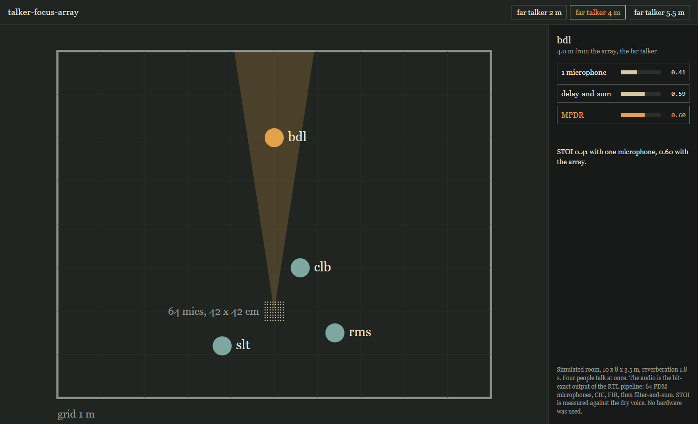

Four people talk at once in a reverberant room. Tap one, hear mostly that one.

64 PDM microphones on a 42 cm board, Verilog for a Zynq-7020:

- `cic_bank`: order-5 CIC per mic, one shared comb pipeline
- `fir_bank`: 121-tap FIR to 16 kHz with CIC droop compensation, one DSP for all channels
- `beam_bank`: 64-tap filter-and-sum, weights loaded at run time
- `host/`: C++ weights, delay-and-sum or MPDR

| LUT | FF | BRAM | DSP | clock |
|---|---|---|---|---|
| 21.7% | 12.1% | 20.5 | 2 | 122.88 MHz, met |

No board. Room, microphones and voices are simulated. Every RTL block is compared bit for bit with the Python model in `model/`.

    pip install -r requirements.txt
    cd scene && python build.py && python pdm_build.py
    cd ../host && make design_weights
    cd ../model && python frontend.py && python focus_check.py
    cd ../web && python make_demo.py

`host/` and the checks run under WSL (g++, iverilog). `synth/top.tcl` is the Vivado batch script. Open `web/index.html` to listen.

Speech: CMU ARCTIC bdl, slt, rms, clb, see `data/speech/COPYING`. Clips in `web/data/` are processed from it.
